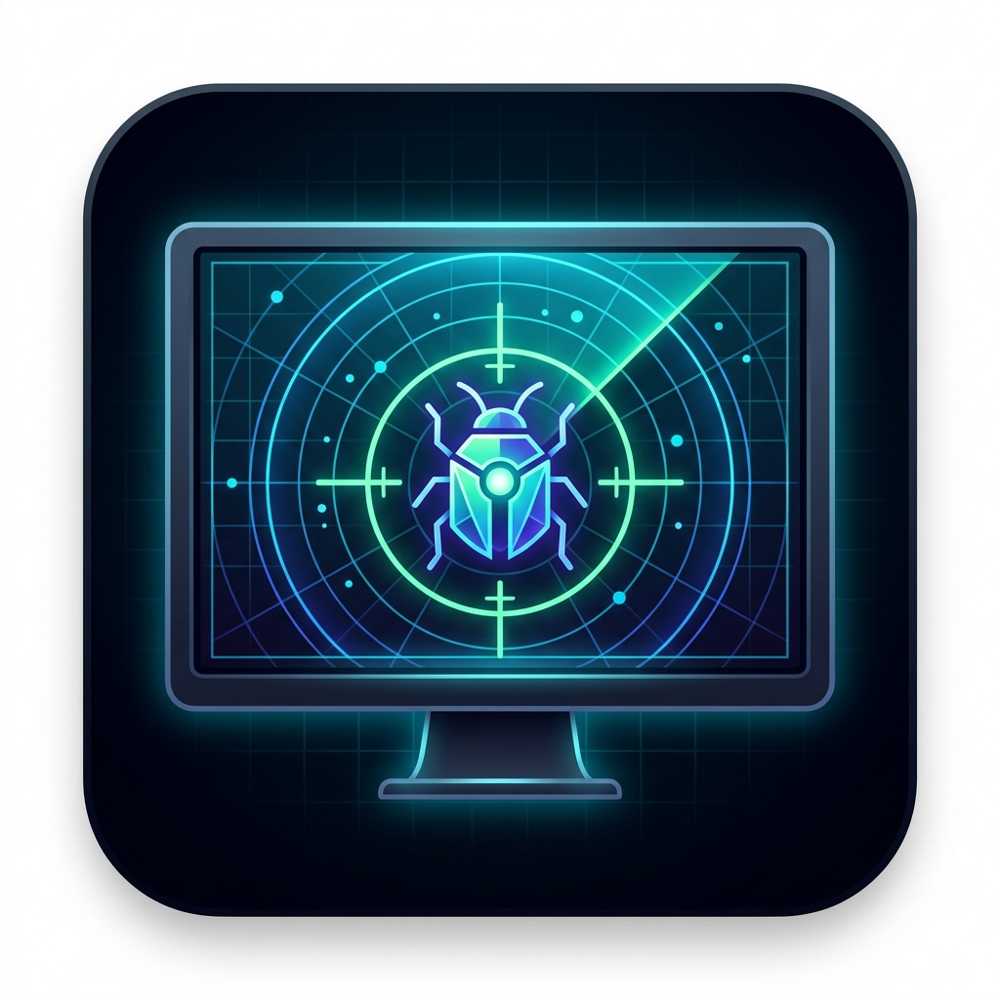

<p align="center">
  
</p>

<h1 align="center">DevLoop</h1>

<p align="center">
  <strong>The Developer Workspace & Error Intelligence Platform.</strong><br>
  Unified project tracking, Kanban boards, headless error ingestion, and bi-directional GitHub sync.<br>
  Built with <strong>Laravel 12</strong>, <strong>Blade</strong>, <strong>Tailwind CSS</strong>, and <strong>Alpine.js</strong>.
</p>

<p align="center">
  <a href="https://github.com/dipambarman/devloop/actions"></a>
  <a href="https://github.com/dipambarman/devloop/blob/main/LICENSE"></a>
  <a href="https://laravel.com"></a>
  <a href="https://php.net"></a>
  <a href="https://laravel.com/docs/pint"></a>
  <a href="https://www.docker.com/"></a>
</p>

---

## ⚡ What is DevLoop?

**DevLoop** bridges the gap between **project management** and **runtime observability**. 

Instead of juggling Jira for tasks, Sentry for unhandled crash logs, Notion for team notes, and GitHub for pull requests, DevLoop unifies your engineering workflow into an ultra-fast, self-hosted, **Cosmic Dark** dashboard designed specifically for developers.

### 🌟 Core Architectural Pillars

- **Pure GitHub OAuth 2.0**: Zero-password storage, automated profile sync, and one-click developer onboarding.
- **Headless Error Ingestion Engine**: Normalizes runtime stack traces, strips variable noise, and generates deterministic SHA-256 fingerprints with atomic upserts.
- **Automatic Regression Detection**: Instantly flags previously resolved bugs that reappear in production, alerting teams via Slack BlockKit.
- **Bi-directional GitHub Webhooks**: Closes tasks and logs polymorphic activity whenever commits (`Fixes #12`) or pull requests merge.
- **Interactive Drag & Drop Kanban**: High-performance board powered by SortableJS with instant state persistence.
- **Developer Dossiers**: Rich profile system featuring bio, tech stack tag chips, and external portfolio links.
- **Production-Ready Docker Stack**: 5-container architecture (PHP 8.3-FPM, Nginx, MySQL 8.4, Redis 7, Background Queue Worker).

---

## 🏗️ System Architecture & Data Flow

```
                             ┌───────────────────────────────┐
                             │    Unhandled Runtime Crash    │
                             └───────────────┬───────────────┘
                                             │ POST /api/bugs/ingest
                                             ▼
                             ┌───────────────────────────────┐
                             │       BugIngestService        │
                             │  - SHA-256 Key Verification   │
                             │  - Stack Trace Normalization  │
                             │  - 16-char Fingerprint Hash   │
                             └───────────────┬───────────────┘
                                             │
                                             ▼
                             ┌───────────────────────────────┐
                             │    ProcessBugIngestJob        │
                             │      (Queued Pipeline)        │
                             │  - Atomic Upsert by (Proj, FP)│
                             │  - Regression State Machine   │
                             └───────┬───────────────┬───────┘
                                     │               │
                     Regression Detected             │ Normal Occurrence
                                     │               │
                                     ▼               ▼
                        ┌────────────────────────┐  ┌───────────────────┐
                        │   SendSlackWebhookJob  │  │ Real-time Metrics │
                        │  (Rich BlockKit Alert) │  │ & Task Association│
                        └────────────────────────┘  └───────────────────┘
```

---

## ✨ Features Deep Dive

### 1. 🐞 Error Monitoring & Crash Tracking
- **Normalized Fingerprints**: Automatically strips memory addresses, timestamps, absolute filesystem paths, and query parameters before hashing.
- **Regression Watchdog**: When an incoming crash fingerprint matches a bug marked as `fixed`, the state machine immediately reopens the bug and triggers high-priority alerts.
- **Slack BlockKit Webhooks**: Dispatches rich Slack cards with error titles, project context, stack traces, and direct links.

### 2. 📋 Interactive Kanban & Task Filtering
- **Drag-and-Drop Columns**: Seamless SortableJS transitions across *Todo*, *In Progress*, *Review*, and *Done*.
- **Unified Query Aliasing**: Filter tasks by status, project, and priority/severity across global views (`/tasks`) and project boards.
- **Prerequisite Dependencies**: Graph-based $O(V + E)$ cycle detection prevents circular dependency deadlocks (`A -> B -> C -> A`).

### 3. 🐙 Bi-directional GitHub Webhooks
- Incoming webhook receiver (`POST /api/webhooks/github` and `/api/projects/{project}/webhooks/github`).
- Supports commit syntax: `Fixes #42`, `Closes #42`, `Resolves #42` or merged Pull Requests.
- Automatically marks tasks **Done**, appends formatted comment citations with commit hashes/authors, and creates polymorphic activity logs.
- Cryptographically verified with project-scoped HMAC-SHA256 (`X-Hub-Signature-256`) secrets.

### 4. 👤 Developer Profile & Workspace
- **Developer Dossier**: Live metric badges, avatar glow, tech stack pills, and GitHub verified badge.
- **Skills Tag Manager**: Fast Alpine.js tag chip adder (type & press <kbd>Enter</kbd> to add, <kbd>×</kbd> to remove).
- **Snippet Line Clamping**: Code blocks exceeding 10 lines clamp with gradient fade overlays and expandable *"Read more (+X lines)"* toggles.
- **Low-Memory Data Exports**: Streamed UTF-8 BOM CSVs (Excel-compatible) and formatted JSON for tasks and error logs.

---

## 🛠️ Tech Stack

| Component | Technology | Version / Implementation |
|:---|:---|:---|
| **Backend Framework** | Laravel | `12.x` |
| **Language** | PHP | `8.3` (OPcache + JIT enabled) |
| **Database** | MySQL | `8.4` (InnoDB Buffer Pool tuned) |
| **Cache & Queue** | Redis | `7.x` Alpine |
| **Frontend Rendering** | Laravel Blade | Server-rendered with Cosmic Dark Design System |
| **Styling** | Tailwind CSS | `3.x` |
| **Interactivity** | Alpine.js + SortableJS | Drag-and-drop & dynamic drawers |
| **Testing Engine** | Pest PHP | `196` tests, `612` assertions (100% pass) |
| **Linter / Formatter** | Laravel Pint | PSR-12 strict formatting |
| **Containerization** | Docker | Multi-stage build + Docker Compose |

---

## 🚀 Quickstart & Installation

### Option A: Local Development

```bash
# 1. Clone repository
git clone https://github.com/dipambarman/devloop.git
cd devloop

# 2. Install PHP and Node dependencies
composer install
npm install

# 3. Configure environment
cp .env.example .env
php artisan key:generate

# 4. Run database migrations & seeders
php artisan migrate --seed

# 5. Build frontend assets and launch servers
npm run build
php artisan serve
```

Visit `http://localhost:8000` in your browser.

---

### Option B: Docker Compose (Production Stack)

DevLoop includes a complete 5-container production stack:

```bash
# Launch Nginx, PHP-FPM, MySQL, Redis, and Queue Worker
docker compose up -d --build

# Run migrations inside the app container
docker compose exec app php artisan migrate --force
```

---

## 🧪 Testing & Code Quality

DevLoop maintains a comprehensive test suite covering authentication, RBAC authorization, error ingestion, state transitions, Slack alerts, and webhook processing:

```bash
# Run the complete test suite
php artisan test

# Verify code formatting against PSR-12 standards
vendor/bin/pint --test
```

```
   PASS  Tests\Feature\Auth\AuthenticationTest
   PASS  Tests\Feature\Bugs\BugIngestTest
   PASS  Tests\Feature\Bugs\BugStateMachineTest
   PASS  Tests\Feature\GitHubWebhookTest
   PASS  Tests\Feature\ProjectExportTest
   PASS  Tests\Feature\SlackWebhookTest
   ...
   Tests:    196 passed (612 assertions)
   Duration: 1.8s
```

---

## 🤝 Contributing

Contributions, issues, and feature requests are welcome!

1. Fork the repository
2. Create your branch (`git checkout -b feature/amazing-feature`)
3. Commit your changes (`git commit -m "feat: add amazing feature"`)
4. Verify tests pass (`php artisan test && vendor/bin/pint --test`)
5. Push to the branch (`git push origin feature/amazing-feature`)
6. Open a Pull Request

---

## 📄 License

This project is licensed under the **MIT License** — see the [LICENSE](LICENSE) file for details.

---

<p align="center">
  Crafted with care by <strong>Dipam Barman</strong><br>
  <strong>Build Together. Grow Together.</strong>
</p>